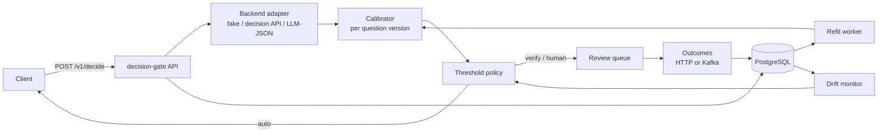

# decision-gate

[](https://github.com/xeeshan16/decision-gate/actions/workflows/ci.yml)


**Calibrated thresholds and human-in-the-loop routing for AI decision models.**

decision-gate sits between your application and any model that answers a question with a
probability: a hosted decision API, a prompted LLM that returns JSON, or a classic
classifier. It records every decision, learns from the real outcomes how much each reported
probability is actually worth, and routes each new decision to one of three tiers:

- **auto**: confident enough, after calibration, to act on without a person;
- **verify**: act, but sample for review;
- **human**: send to a review queue.

> **Status:** under active development (day 1 of a 14-day build). See
> [docs/PLAN.md](docs/PLAN.md) for the roadmap and [docs/PROGRESS.md](docs/PROGRESS.md) for
> the daily log. Sections below marked *planned* do not exist yet.

## The problem

Decision models now return typed answers with probabilities, but those probabilities are
not calibrated to *your* data. A model that says "0.9" may be right 70% of the time on your
tickets, and model-stated confidence is known to be overconfident. Teams end up picking a
threshold by gut feel, never revisit it, and only notice drift after the error rate has
already climbed.

decision-gate turns that into an engineering loop: log decisions, join outcomes, fit a
calibrator per question version, pick thresholds that meet an error budget with
statistical bounds, and tighten automatically when calibration drifts.

## Features

| Feature | Status |
| --- | --- |
| Question schema: `predicate`, `choice`, `score`, versioned per question | ✅ day 1 |
| `DecisionBackend` interface and a deterministic, configurably miscalibrated fake | ✅ day 1 |
| Health, readiness and question catalog API; `dgate` CLI | ✅ day 1 |
| `POST /v1/decide` with PostgreSQL persistence | planned (day 2) |
| Outcome ingestion over HTTP or Kafka | planned (day 3) |
| ECE, Brier, log loss and reliability bins | planned (day 4) |
| Platt, isotonic and temperature calibrators | planned (day 5) |
| Thresholds with Wilson/Clopper-Pearson bounds, conformal sets | planned (day 6) |
| Per-question routing policy and human review queue | planned (days 7-8) |
| Drift detection, shadow mode, simulator, observability | planned (days 9-12) |

## Architecture



Every question kind reduces to the same calibration problem: the backend proposes an answer
and a probability that it is correct, and an outcome later says whether it was. For `score`
questions an answer is correct when it lands within the question's `tolerance`.

## Quick start

Requires Python 3.12+ and [uv](https://docs.astral.sh/uv/).

```bash
git clone https://github.com/xeeshan16/decision-gate.git
cd decision-gate
uv sync
uv run pytest
```

Validate a question catalog:

```console
$ uv run dgate questions check examples/questions.yaml
refund.eligible@v1               predicate
ticket.queue@v1                  choice
ticket.handling_minutes@v1       score
3 question(s) OK
```

Ask the deterministic fake backend for a raw (uncalibrated) decision. The same input always
gives the same answer:

```console
$ uv run dgate ask refund.eligible -q examples/questions.yaml -i '{"order_age_days": 12, "item": "headphones"}'
{
  "question": "refund.eligible@v1",
  "answer": true,
  "confidence": 0.7618304815842805,
  "probabilities": {
    "true": 0.7618304815842805,
    "false": 0.23816951841571954
  },
  "backend": "fake",
  "model_version": "fake-1"
}
```

The fake is deliberately overconfident by default (`overconfidence=2.0`), which is the
problem the rest of the system exists to correct. `fake-gap` measures it on 5,000 synthetic
inputs per question:

```console
$ uv run dgate fake-gap -q examples/questions.yaml
question                          accuracy  confidence     gap
refund.eligible@v1                   0.755       0.849  +0.094
ticket.queue@v1                      0.606       0.788  +0.182
ticket.handling_minutes@v1           0.750       0.845  +0.096
```

Run the API:

```bash
DGATE_QUESTIONS_FILE=examples/questions.yaml uv run dgate serve --port 8080
curl -s localhost:8080/readyz
curl -s localhost:8080/v1/questions/ticket.queue
```

## Configuration

| Variable | Default | Meaning |
| --- | --- | --- |
| `DGATE_QUESTIONS_FILE` | unset | YAML or JSON question catalog |
| `DGATE_BACKEND` | `fake` | Decision backend (more adapters arrive on day 2) |
| `DGATE_FAKE_OVERCONFIDENCE` | `2.0` | Fake backend miscalibration; `1.0` is perfectly calibrated |
| `DGATE_FAKE_SEED` | `decision-gate` | Seed for the fake backend |
| `DGATE_LOG_LEVEL` | `info` | `debug`, `info`, `warning` or `error` |

## Question catalog

```yaml
questions:
  - id: ticket.queue
    version: 1            # bump when the prompt or options change
    kind: choice
    prompt: Which support queue should handle this ticket?
    options: [billing, technical, account, shipping, other]
  - id: ticket.handling_minutes
    kind: score
    prompt: Estimate how many minutes an agent will need.
    min_value: 0
    max_value: 240
    tolerance: 15         # within 15 minutes counts as correct
```

## Development

```bash
uv run ruff check . && uv run ruff format --check .
uv run mypy
uv run pytest --cov
```

CI runs the same checks on Python 3.12 and 3.13, plus `uv build` and a CLI smoke test.

## License

[MIT](LICENSE)
