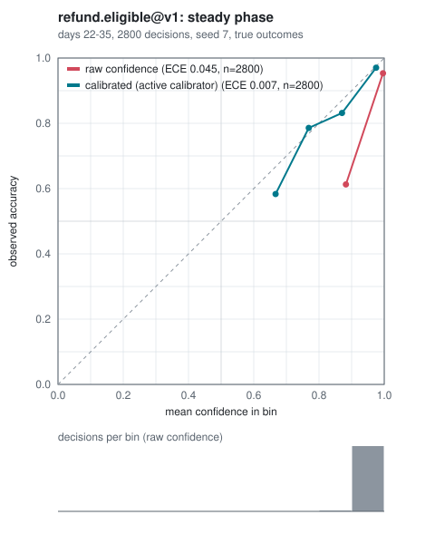
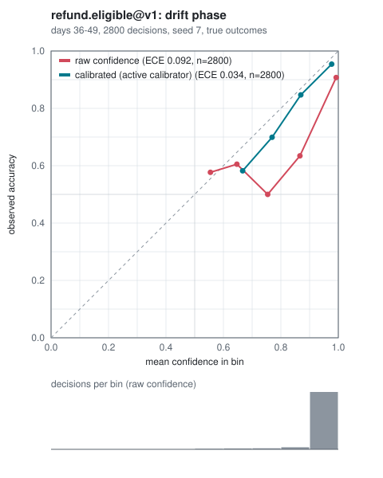
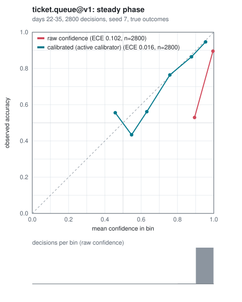
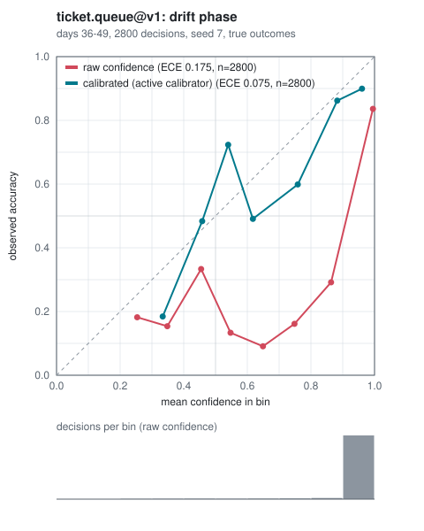

# The statistics behind decision-gate

decision-gate makes one promise: *the decisions it automates are wrong no more often than
the error budget you set, with a stated confidence, on traffic like the traffic it learned
from.* This page explains every statistical piece that promise rests on, what each one
guarantees, and where each guarantee stops. Everything is implemented in plain numpy in
this repository (no scipy, no scikit-learn), and every guarantee below comes with its
assumption spelled out.

Contents: [the core quantity](#1-the-core-quantity) ·
[measuring calibration](#2-measuring-calibration) ·
[calibrators](#3-calibrators-and-honest-evaluation) ·
[thresholds with a guarantee](#4-thresholds-with-a-guarantee) ·
[conformal answer sets](#5-conformal-answer-sets) ·
[drift](#6-drift-when-the-guarantee-stops-holding) ·
[shadow comparisons](#7-comparing-two-models) ·
[what the simulator shows](#8-what-the-simulator-shows) ·
[limits](#9-what-is-not-guaranteed)

## 1. The core quantity

Every question kind (`predicate`, `choice`, `score`) reduces to one pair per decision:

- `c`: the confidence the backend gave *its own answer*;
- `y`: whether that answer turned out correct (for `score` questions, within the
  question's `tolerance`).

Calibration, thresholds and drift are all statements about the relationship between `c`
and `y`. A model is *calibrated* when, among decisions where it says `c = 0.8`, about 80%
are correct. Models that report their own confidence, LLMs especially, are usually
overconfident; the fake backend is overconfident by default (`overconfidence=2.0`) so that
the problem is always visible in the demo.

## 2. Measuring calibration

`dgate calibration report`, `GET /v1/calibration/metrics` and `src/decision_gate/metrics.py`.

| Metric | Definition | Why it is there |
| --- | --- | --- |
| Reliability bins | Group decisions by `c`; per bin, mean `c` vs. observed accuracy | The picture: the reliability diagram |
| ECE | `sum_b (n_b / n) * abs(acc_b - conf_b)` | One number for "how far off" |
| MCE | `max_b abs(acc_b - conf_b)` | The worst bin, which ECE averages away |
| Brier score | `mean((c - y)^2)` | No binning choice; rewards calibration and sharpness |
| Log loss | `-mean(y log c + (1 - y) log(1 - c))` | Punishes confident mistakes hardest |

ECE depends on the binning and is biased upward on small samples (sampling noise alone puts
points off the diagonal). Two mitigations are built in: a seeded **percentile bootstrap**
gives a 95% interval for ECE, and the drift monitor acts on the *lower* end of that
interval, not the point estimate. Reports can split by backend and model version, so two
models are always compared on their own decisions.

`dgate calibration diagram` draws the reliability diagram as a standalone SVG: raw
confidence against the active calibrator, with a strip showing how many decisions fell in
each bin, because a point far from the diagonal backed by a handful of decisions means
little.

## 3. Calibrators and honest evaluation

`src/decision_gate/calibrators.py`, `src/decision_gate/refit.py`.

A calibrator maps `c` to a probability that can be trusted. Three are implemented:

- **Platt scaling**: `p = sigmoid(a * logit(c) + b)`, fitted by Newton's method on the
  cross-entropy with Platt's smoothed targets. Two parameters: little data needed, but it
  can only stretch and shift the curve.
- **Isotonic regression**: the best non-decreasing step function (pool adjacent
  violators), interpolated between steps. Fixes any monotone distortion; needs more data
  (the `auto` method only considers it from 200 training decisions).
- **Temperature scaling**: divides the log-probabilities of the full answer distribution
  by one temperature `T`. It never changes which answer wins, only its probability.
  Predicate and choice questions only.

**Evaluation is chronological and held out.** The refit job sorts labeled decisions by
decision time, fits on the oldest 70% and scores on the newest 30%. A random split would
leak future traffic into training and flatter every method. A new fit is activated only
if its held-out log loss beats both the raw confidences and the currently active
calibrator (Brier breaks exact ties). The registry keeps every fit, so a bad activation can
be rolled back.

A diagram drawn with `dgate calibration diagram` scores the active calibrator on *all*
labels, including the ones it was fitted on, so it looks better than the held-out numbers;
those held-out numbers, stored with every fit, are the honest ones. The simulator's
diagrams (section 8) do not have this problem: each decision is scored with the calibrator
that was active when it was made.

## 4. Thresholds with a guarantee

`src/decision_gate/thresholds.py`, `src/decision_gate/bounds.py`, `src/decision_gate/selection.py`.

The routing policy states an error budget, e.g. `max_error_rate: 0.05` at `confidence:
0.95`. A decision is automated when its calibrated score is at least the auto threshold.
The question is which threshold to pick.

**The naive answer overfits.** "The lowest threshold whose observed precision is at least
95%" tests many thresholds on the same labels; some pass by luck, and the lowest lucky one
is selected.

**What decision-gate does instead: fixed-sequence testing with an exact bound.**

1. Order the candidate thresholds from highest to lowest. The order depends only on the
   scores, never on the labels.
2. For each candidate, accept the decisions at or above it: `k` correct out of `n`. Test
   the null hypothesis "precision below the target" by computing a one-sided lower
   confidence bound on precision. The default is the **Clopper-Pearson** bound, the exact
   inversion of the binomial test, computed by bisection on the regularized incomplete
   beta function. **Wilson** (closed form, tighter, but its coverage can dip below nominal)
   is available.
3. Reject while the bound is at least the target; stop at the first candidate that fails.
   The last rejected candidate is the threshold.

Because the sequence is fixed in advance, testing it this way controls the family-wise
error rate at `1 - confidence` with no multiplicity correction. **The guarantee:** if the
labeled decisions are an i.i.d. sample of the traffic the threshold will be used on, then
with probability at least `confidence` the selected threshold's true precision is at least
the target. Minimum sample sizes (`min_labeled`, `min_accepted`) keep it from automating on
a thin slice of data, and below them nothing is automated.

**Data hygiene.** Scores used for selection come from the active calibrator, so the
calibrator's own training decisions would make the selection optimistic. They are
excluded, except where the calibrator provably cannot change which decisions are accepted
(a strictly increasing map such as Platt with a positive slope, or temperature scaling on
two labels); then the accepted sets are identical to the raw ones and the test is the same
test, so the data is reused. A chronological holdout then reports what the selected
threshold achieved on newer decisions.

The verify tier uses the same procedure with its own, looser budget
(`verify_max_error_rate`); a share of automatable decisions (`verify_sample_rate`) is sent
to verify anyway, so the auto tier keeps producing labels.

## 5. Conformal answer sets

`src/decision_gate/conformal.py`.

For decisions that go to a person, decision-gate can attach a *set* of answers that
contains the true one with probability at least `1 - alpha`, whatever the model and
however badly calibrated it is. Split conformal on `n` labeled decisions:

1. score each decision's true label with a nonconformity score;
2. take `q`, the `ceil((n + 1)(1 - alpha))`-th smallest score (infinite if that rank is
   above `n`: too few decisions to promise the coverage, so every label is in);
3. a new decision's set is every label scoring at most `q`.

Then `P(true label in set) >= 1 - alpha`, and at most `1 - alpha + 1/(n + 1)` without
ties. Two scores: **LAC** (`1 - p(label)`, the smallest sets on average, possibly empty)
and **APS** (cumulative probability of this and every more probable label; never empty,
larger on hard inputs). The guarantee is *marginal* (on average over decisions) and
assumes exchangeability between calibration and future decisions.

## 6. Drift: when the guarantee stops holding

`src/decision_gate/drift.py`, `src/decision_gate/drift_monitor.py`.

Sections 4 and 5 assume tomorrow looks like yesterday. Drift monitoring checks that
assumption with four signals over a current window against a reference window:

| Signal | Needs labels? | Fires when |
| --- | --- | --- |
| Score PSI | no | PSI of raw confidences > `max_score_psi` (0.25) |
| Outcome-mix PSI | yes | PSI of the true-answer distribution > `max_label_psi` (0.25) |
| ECE | yes | the *lower* end of the window's 95% bootstrap ECE interval > `max_ece` (0.05) |
| Auto-tier error | yes | the lower confidence bound on the error rate above the auto threshold > the budget |

PSI is `sum((q - p) * ln(q / p))` over bins whose edges are the reference window's
quantiles (so each bin holds a similar share of the reference, and the PSI depends only on
ranks); empty bins are floored at `1e-4`. The score PSI needs no labels, so it is the
earliest warning; the auto-tier error check is the one tied directly to the promise.

On drift, the default action is to **tighten**: re-select the auto threshold on the
window's own labels, or **suspend** the auto tier when there are too few of them. A routing
refresh cannot loosen a tightened rule while drift lasts. Signed webhooks report
`drift.detected` and `drift.recovered`.

## 7. Comparing two models

`src/decision_gate/shadow.py`.

A candidate backend answers the same inputs in shadow. Raw confidences are not comparable
across models, so each side gets its own calibrator, fitted and evaluated with the same
chronological split, and then:

- **accuracy** is compared with **McNemar's exact test** on the paired decisions (only the
  items where exactly one model was right carry information; under the null each such
  item is a fair coin, so the smaller count is `Binomial(b + c, 1/2)`);
- **auto-tier coverage** is compared by running the router's threshold selection for each
  side under the question's policy.

The verdict is `promote` only if the candidate is not significantly less accurate, does not
automate meaningfully less, and is significantly more accurate or automates meaningfully
more; `keep` otherwise; `insufficient` with too few paired labels.

## 8. What the simulator shows

`dgate simulate run` drives the real service, review queue, refit job, routing refresh and
drift monitor over synthetic traffic whose true answers are known, so it can report the
auto tier's **true** error rate rather than an estimate. The committed run
([simulation-seed-7.md](reports/simulation-seed-7.md), seed 7, 200 decisions per day per
question, model overconfidence 2.0) gives:

- `refund.eligible` (10% budget): 94.4% automated in the steady phase with a true error
  rate of 4.9% (95% CI 4.1%-5.8%). After drift starts, the error on automated decisions
  rises to 11.5% until the monitor suspends the auto tier at the end of day 42.
- `ticket.queue` (5% budget): 67.4% automated at a true error of 5.3% (95% CI
  4.3%-6.4%), which the report flags as *not distinguishable* from the budget rather than
  within it. Drift is detected after four days of drifted traffic.

The second case is the guarantee working as stated, not a failure of it: thresholds are
selected with 95% confidence on a finite sample, so a true rate at or slightly above the
budget is possible some of the time, and the report shows the interval instead of hiding
it. The window between the start of drift and detection is the cost of needing enough new
labels to be sure; smaller windows react faster and raise more false alarms.

Reliability diagrams for every phase of that run, drawn with the calibrator active at each
decision (so out of sample), are in [reports/diagrams](reports/diagrams):

| | steady | drift |
| --- | --- | --- |
| `refund.eligible` |  |  |
| `ticket.queue` |  |  |

In the steady phase the calibrated curve sits close to the diagonal (ECE 0.007 and 0.016
against 0.045 and 0.102 raw); under drift both curves fall below it, which is exactly what
the ECE and auto-error signals pick up.

Regenerate them with:

```bash
uv run dgate simulate run --markdown docs/reports/simulation-seed-7.md --diagrams docs/reports/diagrams
```

## 9. What is not guaranteed

- **Non-i.i.d. labels.** If outcomes arrive only for some kinds of decisions (for example,
  only disputed refunds get a label), every estimate above is biased toward that subset.
  The verify sample exists to keep an unbiased trickle of labels from the auto tier, but
  it cannot fix labels that are missing for reasons tied to correctness.
- **Wrong labels.** Reviewer mistakes are counted as truth. The simulator's
  `--reviewer-accuracy` shows the effect; decision-gate does not model label noise.
- **Per-decision coverage.** Conformal sets and thresholds are guarantees on average over
  decisions, not for any single one, and not per segment unless a segment is its own
  question.
- **Sudden drift.** Detection needs a window of new traffic and labels; decisions made
  between the change and its detection are covered only by the old guarantee.
- **Repeated selection.** Each refresh is a new test on overlapping data. The per-refresh
  guarantee holds, but over many refreshes the chance that *some* selection was unlucky
  grows; drift monitoring on fresh labels is the backstop.
